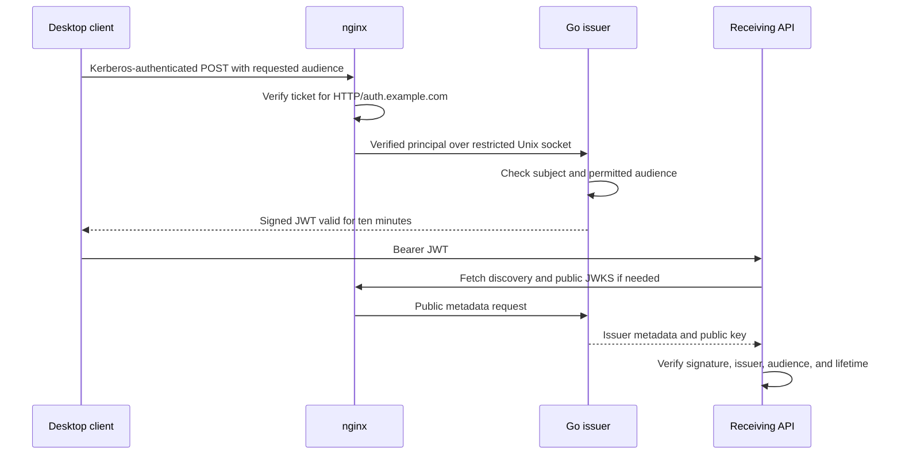

# krb-jwt-issuer

A small Go service that turns an nginx-verified Kerberos identity into a signed JWT for a configured audience. Written for a Raspberry Pi behind nginx; all hostnames below are placeholders (`auth.example.com`, realm `EXAMPLE.COM`).

The issuer is **`https://auth.example.com/issuer`**. The `/issuer` path is part of the issuer identity and must be included exactly in consumer configuration and `iss` validation.

The service implements Kubernetes-style issuer discovery and JWT federation. It does not implement an interactive OIDC authorization-code flow, OAuth client registration, refresh tokens, or a user database. Applications that require a full “Sign in with OIDC” flow need those additional protocol features. The discovery document intentionally advertises only the issuer, public key endpoint, and signing algorithm.

## Status and platforms

This is a personal home-lab project that I publish in case it is useful to others. It is provided as-is, without warranty or support; issues and pull requests are welcome but handled on a best-effort basis.

Tested on **Linux only** (amd64, arm64 and ARMv7, the Raspberry Pi it was built for), behind nginx with a Kerberos (SPNEGO) module and systemd socket activation. Releases are built for those three targets. Other Unix-like systems may work with the `-socket` flag but are untested, and Windows is not a fit for this design.

## What runs

- A static Go binary built for the Pi's 32-bit ARMv7 userspace.
- No third-party runtime dependencies: RS256 signing uses the Go standard library. `golang-jwt` is used only by the tests, as an independent verifier.
- A persistent 3072-bit RSA signing key, using RS256 signatures.
- A separate unprivileged `krb-jwt-issuer` account, with no Kerberos keytab access.
- A systemd-owned Unix socket readable only by nginx's `www-data` user.
- No TCP listener, database, containers, or external identity service.

The first deployment used about **6.1 MiB resident memory** after end-to-end tests (measured before the dependency removal and rate limiter; re-measure). The static executable is about 7 MiB. The unit sets `GOMEMLIMIT=48MiB` and `MemoryMax=96M`. Public documents are encoded once at startup, and the rate limiter holds one small entry per authorized principal.

## Endpoints

| Endpoint | Access | Purpose |
| --- | --- | --- |
| `GET /issuer` | No Kerberos required | `302` redirect to the discovery document, so the bare issuer URL is useful in a browser |
| `GET /issuer/.well-known/openid-configuration` | No Kerberos required, reachable on LAN/VPN | Discover the issuer and signing-key location |
| `GET /issuer/jwks.json` | No Kerberos required, reachable on LAN/VPN | Fetch public RSA keys |
| `GET /issuer/whoami` | Kerberos | Return your subject, allowed audiences, and issuer |
| `POST /issuer/mint` | Kerberos, explicit audience, JSON request header | Mint a short-lived bearer token |
| `GET /whoami` | Kerberos | Return the verified principal as plain text |

Example links:

- [Discovery](https://auth.example.com/issuer/.well-known/openid-configuration)
- [Public keys](https://auth.example.com/issuer/jwks.json)
- [Identity and allowed audiences](https://auth.example.com/issuer/whoami)

There is also a `/healthz` endpoint inside the Unix-socket service. nginx does not expose it.

## Check your setup

After installing, run the built-in self-check from a desktop that has a Kerberos ticket (`kinit` first). It needs only this binary and a `curl` built with GSS-API (`curl -V` should list `GSS-API` and `SPNEGO`):

```bash
krb-jwt-issuer check -url https://auth.example.com/issuer -audience homelab-test
```

It tests what the README promises, from the outside, and prints a specific fix for anything wrong:

- discovery and public keys work without Kerberos, the issuer URL matches exactly, and no private key material is published;
- nginx rejects anonymous requests and **ignores or overwrites a forged `X-Authenticated-Principal` header** (the most important misconfiguration to catch);
- your principal is authorized for the audience;
- a minted token **verifies against the published keys** with the right `iss`, `aud` and lifetime (tokens are never printed);
- unconfigured audiences, foreign origins and requests without `X-Token-Request` are refused.

Exit status is 0 when healthy, 1 when a check fails, and 2 for a usage error. Use `-principal user@REALM` to assert who you expect to be, `-cacert ca.pem` for a private certificate authority, and `-public-only` on a machine without a ticket, such as the host that will verify tokens, to confirm it can reach discovery and the keys. The check mints one token, so it stays well inside the rate limit.

## Mint your first token

Run this as your normal desktop user, with valid Kerberos tickets:

```bash
klist

curl --noproxy '*' --negotiate -u : --fail-with-body \
  -H 'Content-Type: application/json' \
  -H 'X-Token-Request: 1' \
  --data-binary '{"audience":"homelab-test"}' \
  https://auth.example.com/issuer/mint
```

The response contains `access_token`, `token_type: "Bearer"`, and `expires_in: 600`. The token is a bearer credential: a receiving service can accept whoever presents it until it expires. Keep it out of logs and shared screenshots.

The mint endpoint is a custom federation API, not the standard OAuth token endpoint. `X-Token-Request: 1`, JSON content type, and origin validation prevent cross-origin forms and ordinary cross-origin fetches from causing minting. Minting is rate-limited twice. The issuer allows each authorized principal a sustained 30 tokens per minute with bursts of 10, returning `429` with `Retry-After`. nginx additionally limits requests that carry a Negotiate token to the same rate per client IP; the unauthenticated 401 challenge round trip is deliberately not counted, because `limit_req` runs before authentication.

The example configuration allows one principal and one test audience, `homelab-test`. Enrol real applications by adding explicit audiences.

## How the trust chain works



nginx overwrites `X-Authenticated-Principal` with its verified `$remote_user`; it never trusts the client's value. nginx only **authenticates**. Authorization (which principals may mint, for which audiences) is decided in one place, the issuer's `config.json`, so adding a principal never requires an nginx change. Any principal in your realm can reach the issuer and receives `403 subject_not_allowed` unless configured.

The socket `/run/krb-jwt-issuer.sock` is mode 0600, owned by `www-data`. This socket permission is the trusted-proxy boundary. Do not expose the issuer directly through a TCP listener or make the socket accessible to arbitrary local users. The issuer never receives your desktop password or Kerberos ticket; nginx removes the Authorization header before forwarding.

Signed tokens contain:

| Field | Meaning |
| --- | --- |
| `iss` | Exactly `https://auth.example.com/issuer` |
| `sub` | The authenticated Kerberos principal |
| `aud` | One explicitly permitted audience, encoded as an array |
| `iat` and `nbf` | Issuance time and start of validity |
| `exp` | Expiry, ten minutes after issuance |
| `jti` | A fresh random token identifier |
| Header `kid` | The signing key's SHA-256 JWK thumbprint |

Clients cannot supply their own subject, expiry, issuer, or arbitrary claims. Tokens are signed, not encrypted. The service has no per-token revocation database; deleting a token locally does not invalidate another copy. Short expiry limits the lifetime of already-issued credentials.

## Connect a receiving application

Configure the consumer with the exact issuer URL, its own expected audience, and RS256 as the allowed signing algorithm. It should retrieve and cache public keys from the advertised `jwks_uri`, select the key by `kid`, and validate signature, `iss`, `aud`, `exp`, and `nbf`. Use a maintained JWT or OIDC verification library rather than implementing signature verification yourself. A small clock-skew tolerance is reasonable, but both machines should synchronize time.

Different apps should have distinct audience values. A token for one app should fail verification at another. Map `sub` to a local application identity and decide permissions there; a signed identity does not automatically grant administrator access.

Consumers must be able to resolve `auth.example.com` to the Pi and reach it over HTTPS on the LAN/VPN. Discovery and JWKS do not require Kerberos because background validators generally do not have a desktop ticket. They are served with `Cache-Control: public, max-age=300`; keep rotated public keys published much longer than that. Your firewall still controls network access.

This is not a Kubernetes ServiceAccount issuer implementation: it has no TokenRequest or TokenReview API, no pod binding, and no Kubernetes private claims. Its discovery and signed tokens were successfully consumed by `coreos/go-oidc`, a verifier used in the Kubernetes ecosystem.

## Configuration and installed files

The live configuration is `/etc/krb-jwt-issuer/config.json` on the Pi, generated by `install.py` from [config.example.json](config.example.json).

```json
{
  "issuer": "https://auth.example.com/issuer",
  "private_key_file": "/var/lib/krb-jwt-issuer/signing.key.pem",
  "previous_public_keys_dir": "/var/lib/krb-jwt-issuer/previous-public-keys",
  "token_lifetime_seconds": 600,
  "subjects": {
    "alice@EXAMPLE.COM": ["homelab-test"]
  }
}
```

To add an audience or a principal, edit `subjects` (for example add `notes-api`) and restart `krb-jwt-issuer.service`; no nginx change is needed. Lifetime is configurable between 30 and 900 seconds. No wildcard audiences are allowed.

| Path on Pi | Purpose |
| --- | --- |
| `/usr/local/libexec/krb-jwt-issuer` | Static executable |
| `/etc/krb-jwt-issuer/config.json` | Issuer URL, key paths, lifetime, and subject-to-audience permissions |
| `/var/lib/krb-jwt-issuer/signing.key.pem` | Persistent private key, owned by `krb-jwt-issuer`, mode 0600 |
| `/var/lib/krb-jwt-issuer/previous-public-keys/` | Optional old public keys retained during rotation |
| `/run/krb-jwt-issuer.sock` | systemd socket; nginx is its permitted client |
| `/etc/systemd/system/krb-jwt-issuer.socket` | Socket activation and access permissions |
| `/etc/systemd/system/krb-jwt-issuer.service` | Unprivileged account and service sandbox |
| `/etc/nginx/conf.d/krb-jwt-issuer.conf` | HTTPS, Kerberos, public metadata exceptions, and proxy configuration |
| `/etc/nginx/krb5-auth.keytab` | nginx's separate HTTP service key, root:www-data, mode 0640 |

The key is generated on first startup and reused thereafter. Creation is atomic: the key is fully written and synced to a temporary file and then hard-linked into place, so a crash cannot leave a truncated key, and an existing key is never replaced. A malformed or overly permissive existing key causes startup to fail. The service has a private network namespace and no writable access to the nginx configuration or its Kerberos keytabs.

Consumers and desktops must resolve the hostname to the Pi (for example a Pi-hole `dns.hosts` record or `/etc/hosts`). Browsers need the hostname in their Kerberos allowlists; `deploy/configure-browsers.py --host auth.example.com` adds it to Firefox and Brave policies. The TLS certificate must cover the hostname. No router forwarding or extra TCP port is needed.

## Operate and troubleshoot

On the Pi:

```bash
sudo systemctl status krb-jwt-issuer.socket krb-jwt-issuer.service
sudo journalctl -u krb-jwt-issuer.service --since today
sudo nginx -t
sudo systemctl restart krb-jwt-issuer.service
```

The socket unit is enabled for boot; the service starts through socket activation. Logs include subject, audience, token identifier, and expiry, but never the JWT or private key.

| Result | Meaning |
| --- | --- |
| 401 from mint | Missing or invalid Kerberos authentication |
| 403 | Unauthorized subject, audience, or browser origin |
| 400 | Malformed JSON, unknown claim field, or missing `X-Token-Request` header |
| 415 | Content type is not JSON |
| 429 | nginx mint rate limit reached; wait before retrying |
| 502 | Check the issuer service and socket permissions |

If a browser cannot open the identity endpoint, inspect `about:policies` in Firefox or `brave://policy` in Brave. Policies may refresh while running; otherwise restart the browser. If `klist` shows no valid TGT, run `kinit alice@EXAMPLE.COM` or log in again.

Brave is configured with `DisableAuthNegotiateCnameLookup: true`. If your resolver reports a different canonical name for the hostname, Chromium can otherwise request a service ticket for the wrong name; the policy keeps the Kerberos service name aligned with the URL hostname.

## Key rotation and backups

Rotation uses an overlap period: mint with the new private key while publishing both public keys long enough for existing tokens and verifier caches to age out.

1. Stop both `krb-jwt-issuer.socket` and `krb-jwt-issuer.service` so incoming requests cannot reactivate the old process during maintenance.
2. Export the current **public** key with the binary's `-print-public-key` option and save it as a `.pem` file under `previous-public-keys`. Run the binary as `krb-jwt-issuer` using the live config. This option prints public material only.
3. Move the old private key to a protected backup outside that public-key directory. Leave the active key path absent.
4. Start the socket and service. Startup generates a new private key, while the previous public key remains in JWKS.
5. Confirm a new `kid` and verify tokens against the published keys. Keep the previous public key at least through the old token lifetime plus consumer cache and clock-skew allowances; an hour is a practical initial overlap for this ten-minute setup.
6. Remove the old public key from the published directory after that overlap and restart the service. Retain or destroy the backed-up private key according to your recovery needs.

For example, inspect the active public key without exposing private material:

```bash
sudo -u krb-jwt-issuer /usr/local/libexec/krb-jwt-issuer \
  -config /etc/krb-jwt-issuer/config.json -print-public-key   # read-only: never creates a key
```

Back up the configuration and signing key together, plus the nginx and systemd configuration. Protected off-device backups are needed to recover the same signing identity after losing the Pi; configuration rollback snapshots alone do not back up the generated private key.

`install.py` and `configure-browsers.py` save copies of files they replace under `/root/krb-jwt-issuer-before-<timestamp>/` and `/root/krb-jwt-issuer-client-before-<timestamp>/`. There is no scheduled signing-key backup; arrange one yourself.

To disable this issuer without affecting Pi-hole, stop and disable `krb-jwt-issuer.socket`, stop `krb-jwt-issuer.service`, move `/etc/nginx/conf.d/krb-jwt-issuer.conf` out of the `*.conf` include directory, validate nginx, and reload it. Preserve the state directory and key until you decide whether to retire existing tokens. Metadata becoming unavailable is not immediate revocation for validators that have cached keys.

## Source and validation

- [main.go](main.go): service, key handling, metadata, and minting.
- [main_test.go](main_test.go), [formal_test.go](formal_test.go): unit, requirement-tagged and fuzz tests.
- [deploy](deploy/): nginx, systemd, initial installation, and browser configuration.
- [integration](integration/): a separate Go module that verifies the deployed service with `coreos/go-oidc`. Its dependencies are not included in the production binary.

From this directory:

```bash
go test -race ./...
go vet ./...
CGO_ENABLED=0 GOOS=linux GOARCH=arm GOARM=7 \
  go build -buildvcs=false -trimpath -ldflags=-s \
  -o krb-jwt-issuer .
```

Installation from a release. Download the archive for your architecture from the Releases page, verify it, then install (see [RELEASING.md](RELEASING.md) for the verification commands):

```bash
gh attestation verify krb-jwt-issuer-vX.Y.Z-linux-armv7.tar.gz -R obegron/krb-jwt-issuer
tar xzf krb-jwt-issuer-vX.Y.Z-linux-armv7.tar.gz && cd krb-jwt-issuer-vX.Y.Z-linux-armv7
sudo python3 deploy/install.py --host auth.example.com --realm EXAMPLE.COM \
  --subject alice@EXAMPLE.COM --cert-dir /etc/nginx/ssl/example.com \
  --sha256 <digest from the verified SHA256SUMS> [--pihole-ip 192.0.2.10]
```

`install.py` intentionally rejects an existing deployment and needs `kadmin.local` access to create the `HTTP/<host>` service key. For updates, stop the service and socket, install the new verified executable atomically while retaining the old binary for rollback, then restart. Keep `/var/lib/krb-jwt-issuer/` intact to preserve the signing key. **When upgrading from a version whose nginx config contained `auth_gss_authorized_principal`, replace `/etc/nginx/conf.d/krb-jwt-issuer.conf` with the current template** and reload nginx, so authorization lives only in the issuer config.

The integration runner uses your current Kerberos session and keeps bearer tokens in memory. It reads the deployment from the environment; `RESTART_CMD` is optional and enables the restart-persistence check:

```bash
cd integration
ISSUER_URL=https://auth.example.com/issuer PRINCIPAL=alice@EXAMPLE.COM \
RESTART_CMD='ssh admin@pi sudo -n systemctl restart krb-jwt-issuer.service' \
  go run -buildvcs=false .
```

See [TESTING.md](TESTING.md) for the formal test plan and requirement traceability.
